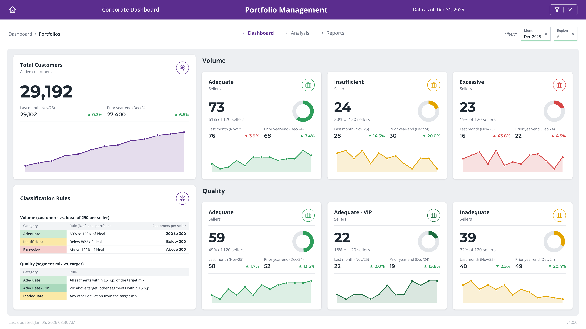
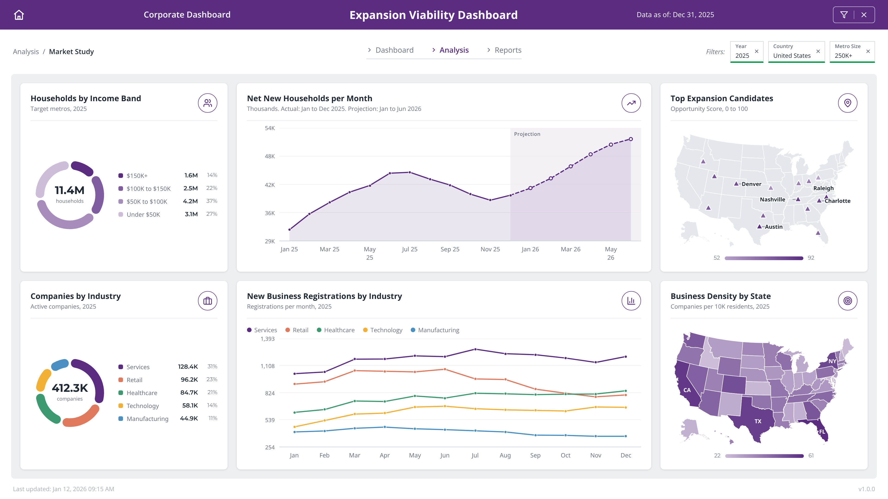
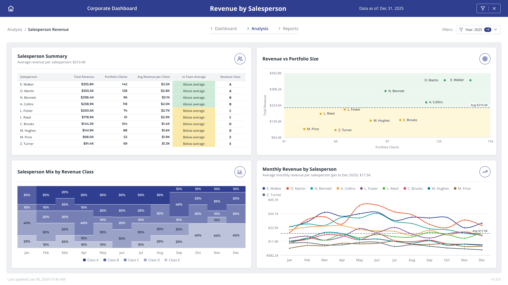
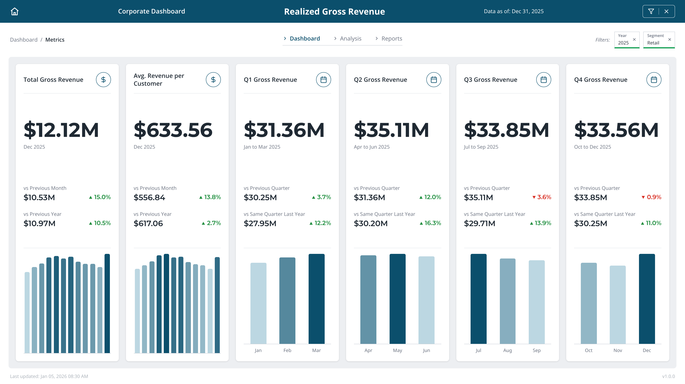

# Qlik-Style Dashboard Portfolio: Lucas Tiezerin

This repository presents corporate dashboards **inspired by real Qlik Sense projects** from my professional work.

> **These dashboards were recreated in Python (HTML/CSS rendered with Playwright), not built in Qlik Sense.**
> All data, names, KPIs, and business context are **synthetic**. No real organization, customer, or figure is represented.
> The goal is to reproduce the structure, analytical logic, and visual language of the original projects.

Each dashboard is available as a high-resolution PNG (click the image) and as a PDF.

---

---

# DAR Methodology

All dashboards follow the **DAR** structure (Dashboard, Analysis, Report), a way of organizing an analytical application in three layers, from the broadest view to the most detailed:

- **Dashboard:** KPIs and an overview of the topic, for a quick read of where things stand.
- **Analysis:** deeper dives by theme, to understand the "why" behind the numbers.
- **Report:** tabular analyses at the lowest level of detail, for those who need to see the records.

The navigation tabs at the top of each dashboard reflect this structure. This portfolio covers the first two layers:

| Dashboard | DAR layer |
|---|---|
| Portfolio Management | Dashboard |
| Realized Gross Revenue | Dashboard |
| Expansion Viability Dashboard | Analysis |
| Revenue by Salesperson | Analysis |

# Dashboards

## 1) Portfolio Management

**Objective:**
Classify the customer portfolio of each salesperson by volume and quality, and track how the distribution evolves over time.

**Highlights:**

- Total customers with variation vs last month and vs prior year-end
- Volume classification (Adequate, Insufficient, Excessive) against an ideal portfolio size
- Quality classification (Adequate, Adequate - VIP, Inadequate) based on segment mix vs target
- Mini donuts and trend lines for each category
- Classification rules displayed on the dashboard itself

**Usage:**
Supports portfolio management and workload balancing across the sales team.

[PDF version](dashboards/pdf/portfolio_management.pdf)

---

## 2) Expansion Viability Dashboard

**Objective:**
Evaluate which US metropolitan areas are the most promising for business expansion.

**Highlights:**

- Households by income band and companies by industry
- Net new households per month, with actual data and projection
- New business registrations by industry over the year
- Opportunity score for top expansion candidates and business density by state (maps)

**Usage:**
Supports market studies and the prioritization of expansion targets.

[PDF version](dashboards/pdf/expansion_viability_dashboard.pdf)

---

## 3) Revenue by Salesperson

**Objective:**
Compare salesperson revenue against the team average and rank performance by revenue class.

**Highlights:**

- Summary table with total revenue, portfolio size, and average revenue per client
- Revenue vs portfolio size scatter with above and below average zones
- Salesperson mix by revenue class over the months
- Monthly revenue trend per salesperson against the team average

**Usage:**
Helps identify top performers and separate the effect of portfolio size from revenue per client.

[PDF version](dashboards/pdf/revenue_by_salesperson.pdf)

---

## 4) Realized Gross Revenue

**Objective:**
Monitor realized gross revenue and its variation across months and quarters.

**Highlights:**

- Total gross revenue and average revenue per customer
- Quarterly view with comparison vs previous quarter and vs same quarter last year
- Monthly bars highlighting the strongest period in each card

**Usage:**
Gives leadership a quick read of revenue performance and growth against prior periods.

[PDF version](dashboards/pdf/gross_revenue_dashboard.pdf)

---

# Tools

- **Python** (dashboard generation)
- **HTML/CSS** (layout and visual design)
- **Playwright** (PNG and PDF rendering)
- **uv** (environment and dependency management)

---

# See Also

**Power BI Portfolio:** dashboards built in a real production environment, with masked data.
[lucas-tiezerin-power-bi-portfolio](https://github.com/l-tiezerin/lucas-tiezerin-power-bi-portfolio)

---

# About Me

**Lucas Eduardo Duarte Tiezerin**
Data Analyst | Analytics Engineer | BI Developer

4+ years of experience working with analytics, BI, and data automation in production environments, focusing on scalable solutions and business impact.

LinkedIn:
[https://www.linkedin.com/in/lucas-eduardo-duarte-tiezerin-9660171ab](https://www.linkedin.com/in/lucas-eduardo-duarte-tiezerin-9660171ab)

GitHub:
[https://github.com/l-tiezerin](https://github.com/l-tiezerin)